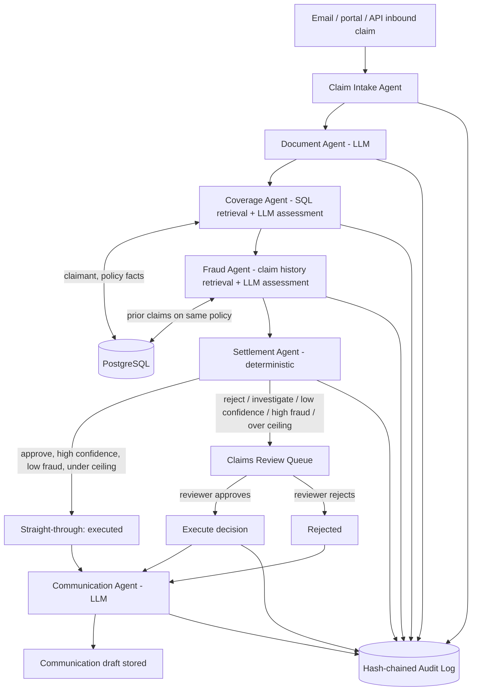

# Architecture — Intelligent Insurance Claims Processing

## Trust boundaries

- Inbound claim narratives and attached-document text are **untrusted** the moment they enter the
  pipeline. They're wrapped (`app/security.py:sanitize_untrusted_text`) before any LLM call, and
  scanned for prompt-injection markers — scan results are included as evidence for LLM fraud triage.
- The Coverage Agent performs exact, parameterized database lookups using extracted identifiers,
  then gives only the matching claimant/policy facts to the LLM for a structured assessment. A
  consistency gate prevents `is_covered=true` when the database cannot verify the claimant, policy,
  and their match, or when any required model-reported check fails; settlement guardrails still
  require human approval for adverse or risky decisions.
- The Fraud Agent retrieves a compact history of earlier claims on the same policy and combines it
  with extracted claim facts and prompt-injection scan results. Raw claim narrative and attachment
  text are scanned locally and are not sent in this additional LLM call. The LLM supplies the risk
  score and explanations; invalid scores fail the pipeline rather than being silently corrected.
  This is risk triage, not a finding of fraud.
- The Settlement Agent only ever *proposes* a decision; only the maker-checker review endpoint
  (`POST /decisions/{id}/review`) or straight-through eligibility can move it to `executed`.

## Data model

`Claimant` 1—N `Policy`; `Claim` references a resolved `Claimant`/`Policy` plus raw inbound content
and per-stage confidence/fraud scores; `Claim` 1—N `ClaimDecision` (idempotent per
`claim_id`+`decision_type`); `Claim` 1—N `CommunicationDraft`; `AuditLog` is append-only and
hash-chained across the whole table, so any row tampering breaks the chain from that point forward —
verify with `GET /audit/verify_chain`.

`Policy.claimed_amount_ytd` is only ever **incremented** by an executed `approve` decision, never
overwritten — several claimants in the synthetic dataset hold policies targeted by more than one
claim, so a naive "set remaining coverage" write would let one claim's settlement clobber another's
effect on the same policy. (This mirrors a real bug found and fixed in Project 1's account-holds
model — see that project's README for the incident.)
